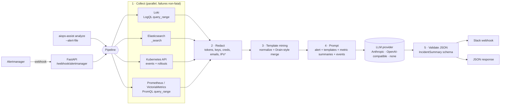

# aiops-incident-assistant

[](https://github.com/ozy31/aiops-incident-assistant/actions/workflows/ci.yml)


An Alertmanager webhook receiver that does the first ten minutes of triage for you.
When an alert fires, it pulls the surrounding error logs (Loki and/or Elasticsearch),
the metric history (Prometheus or VictoriaMetrics) and recent Kubernetes events and
rollouts. It compresses the logs into a few templates, **redacts secrets and PII**, and
asks an LLM for a structured incident note: probable cause, evidence, blast radius,
next checks and a confidence level. The note goes to Slack and comes back as JSON.

> The model only sees what the collectors gathered, and the output is a starting point
> for a human. It is not a root-cause oracle. See [Limitations](#limitations).

---

## The problem

Most of the time to resolve an incident goes into finding where to look, not into
fixing it. A typical page means opening four tabs: the alert, a log query you rebuild
from the alert labels, a dashboard to see when the metric moved, and `kubectl` to check
whether anything was deployed. Then you scroll through thousands of almost identical
log lines.

This service automates that loop:

1. It derives the log query and the PromQL from the alert itself, using its labels and
   the rule expression in `generatorURL`.
2. It collapses thousands of log lines into a small set of templates with counts, so
   the context fits in a prompt and a person can read it.
3. It asks the model to tie each claim to evidence from the context, and to say so
   when the evidence is thin.

## How it works



\* IP redaction is opt-in.

| Stage | What happens |
|---|---|
| Time window | `startsAt - LOOKBACK_MINUTES` to `startsAt + LOOKAHEAD_MINUTES` (default 30 and 5). |
| Loki | The stream selector is built from alert labels that exist (`namespace`, `app`, `service`, `job`, `pod`, `container`), with a regex line filter for `error\|exception\|fatal\|panic\|timeout\|...`. You can override it per rule with an `aiops_logql` annotation. |
| Elasticsearch | `query_string` plus `term` filters mapped from alert labels (for example `namespace` to `kubernetes.namespace`). Works with OpenSearch too. |
| Metrics | Runs the alert's own expression (`g0.expr` from `generatorURL`) and any extra PromQL templates you configure (`{namespace}` placeholders are filled from labels). Each series is reduced to min, max, avg and last plus about 12 downsampled points. |
| Kubernetes | Optional. Reads recent events for the workload and the last 3 ReplicaSets (revision, image, ready count) or the StatefulSet revision. Read-only RBAC. |
| Redaction | Runs on every log line, event message, alert label and annotation **before** clustering. Template examples therefore never contain the original secret. |
| Template mining | Variable tokens (timestamps, UUIDs, IPs, hex ids, numbers, durations, quoted strings) become typed placeholders. Templates with the same length and first token that are at least 70% similar are then merged and the differing positions become `<*>`. This is a simplified single-level [Drain](https://jiemingzhu.github.io/pub/pjhe_icws2017.pdf). |
| LLM | Structured JSON output that is validated against a Pydantic model. If validation fails, the analysis fails loudly instead of posting garbage. |

## Quickstart (docker compose demo)

The demo runs Loki, Prometheus and Alertmanager, a fake `checkout-api` that pushes
logs and exposes metrics, and the assistant. Every 6 minutes the fake app simulates an
incident (database pool exhaustion), `HighErrorRate` fires, and Alertmanager calls the
assistant. Some of the demo log lines deliberately contain fake tokens, a fake DB
password and an email address so you can watch the redaction work.

```bash
git clone https://github.com/ozy31/aiops-incident-assistant && cd aiops-incident-assistant

# Option A: no API key; "none" provider gives a mechanical digest, no LLM call
docker compose -f deploy/compose/docker-compose.yml up -d --build

# Option B: real summaries with Claude
export ANTHROPIC_API_KEY=sk-ant-...
AIOPS_LLM_PROVIDER=anthropic docker compose -f deploy/compose/docker-compose.yml up -d --build

# Option C: a local model through any OpenAI-compatible server (e.g. Ollama on the host)
AIOPS_LLM_PROVIDER=openai AIOPS_OPENAI_MODEL=llama3.1:8b \
  docker compose -f deploy/compose/docker-compose.yml up -d --build

# Watch it work (first alert after about 2-3 minutes: 60s warm-up + 1m "for:" + group_wait)
docker compose -f deploy/compose/docker-compose.yml logs -f assistant
```

| UI | URL |
|---|---|
| Prometheus (alerts) | http://localhost:9090/alerts |
| Alertmanager | http://localhost:9093 |
| Assistant API docs | http://localhost:8080/docs |
| Assistant metrics | http://localhost:8080/metrics |

You can also send the sample payload by hand. `?wait=true` returns the result in the
response instead of processing it in the background:

```bash
curl -s -X POST 'localhost:8080/webhook/alertmanager?wait=true' \
  -H 'Content-Type: application/json' --data @examples/alert-sample.json | jq .
```

Stop the demo with `make demo-down`.

## CLI (offline / ad-hoc)

```bash
python3.12 -m venv .venv && . .venv/bin/activate
pip install -e ".[k8s]"

# No LLM: mechanical digest (useful to check wiring)
aiops-assist analyze --alert-file examples/alert-sample.json --provider none

# Show exactly what would be sent to the model, after redaction, without calling it
AIOPS_LOKI_URL=http://localhost:3100 AIOPS_PROMETHEUS_URL=http://localhost:9090 \
  aiops-assist analyze -f examples/alert-sample.json --show-prompt

# Real run with Claude
export ANTHROPIC_API_KEY=sk-ant-...
aiops-assist analyze -f examples/alert-sample.json

# Run the service
aiops-assist serve --port 8080
```

`--alert-file` accepts a full Alertmanager webhook payload, a list of alerts or a
single alert object.

## Deploy on Kubernetes (Helm)

```bash
kubectl -n monitoring create secret generic aiops-assistant \
  --from-literal=ANTHROPIC_API_KEY=sk-ant-... \
  --from-literal=AIOPS_SLACK_WEBHOOK_URL=https://hooks.slack.com/services/... \
  --from-literal=AIOPS_WEBHOOK_TOKEN="$(openssl rand -hex 24)"

helm upgrade --install aiops-incident-assistant deploy/helm/aiops-incident-assistant \
  -n monitoring \
  --set secrets.existingSecret=aiops-assistant \
  --set config.LOKI_URL=http://loki-gateway.monitoring.svc \
  --set config.PROMETHEUS_URL=http://prometheus-operated.monitoring.svc:9090 \
  --set kubernetesContext.enabled=true \
  --set serviceMonitor.enabled=true
```

Then route alerts to it. [`deploy/helm/alertmanager-receiver.example.yaml`](deploy/helm/alertmanager-receiver.example.yaml)
has both a plain `alertmanager.yml` snippet and an `AlertmanagerConfig` CRD for the
Prometheus Operator. Both use `continue: true`, so your existing paging route is
unchanged and the assistant only adds context.

The chart runs as UID 10001 with a read-only root filesystem, drops all capabilities
and only mounts a service-account token when `kubernetesContext.enabled=true`. RBAC is
read-only (`get`/`list` on events, deployments, replicasets and statefulsets). It can
be a namespaced `Role` instead of a `ClusterRole`.

## Example input and output

**Input:** [`examples/alert-sample.json`](examples/alert-sample.json) is a standard
Alertmanager v4 webhook payload for `HighErrorRate` on `shop/checkout-api`.

**Output:** the shape is shown below. The full file is
[`examples/summary-example.json`](examples/summary-example.json).

> ⚠️ **This is an illustrative example, written by hand to document the output
> format.** It was not captured from a real incident or a real model run, and the
> numbers in it are made up.

```json
{
  "alert_name": "HighErrorRate",
  "provider": "anthropic",
  "model": "claude-opus-5-5",
  "summary": {
    "title": "checkout-api 5xx spike: payments-db connection pool exhausted",
    "summary": "checkout-api in namespace shop started returning 5xx at about 14:31 UTC ...",
    "probable_cause": "Database connection pool exhaustion towards payments-db, likely triggered by the 14:27 rollout ...",
    "evidence": [
      "2981x 'PoolTimeoutError: timed out after <DUR> acquiring connection from pool <STR> (active=<NUM> idle=<NUM> max=<NUM>)'",
      "5xx ratio query: min=0.004 max=0.231 last=0.218 over the window",
      "ReplicaSet checkout-api-7d9f8b6c5d (revision 42, image checkout-api:1.18.0) created 14:27"
    ],
    "blast_radius": "Checkout requests for shop/checkout-api; other payments-db clients may be affected.",
    "suggested_next_checks": [
      "kubectl -n shop rollout history deploy/checkout-api ...",
      "Check payments-db active connections and slow query log ..."
    ],
    "confidence": "medium",
    "confidence_rationale": "Logs, metrics and rollout timing agree, but no DB-side metrics were available."
  },
  "context_stats": { "raw_log_lines": 3177, "log_templates": 3, "redactions_total": 336, "...": "..." },
  "errors": []
}
```

The same result is posted to Slack as a Block Kit message: a header, the summary,
cause, blast radius and confidence fields, evidence and next-check bullets, and a
footer with the provider/model, log-lines-to-templates count and redaction count.

**How much smaller is the context?** On the demo generator's synthetic incident logs
(300 one-second batches of incident-mode error/warn lines, seeded run), 3,177 lines (~396 KB) became 3 templates
(~1.1 KB of JSON). That data is very repetitive by design. Real logs with more variety
compress much less, so measure on your own data with `--show-prompt`.

## Configuration

All settings are environment variables with the `AIOPS_` prefix (pydantic-settings).
A `.env` file in the working directory is also read; see [`.env.example`](.env.example).
List and dict values are JSON, for example `AIOPS_LOKI_SELECTOR_LABELS='["namespace","app"]'`.

| Variable | Default | Description |
|---|---|---|
| `AIOPS_LLM_PROVIDER` | `anthropic` | `anthropic`, `openai` (any OpenAI-compatible endpoint) or `none` (no LLM). |
| `ANTHROPIC_API_KEY` | – | Read by the Anthropic SDK itself. |
| `AIOPS_ANTHROPIC_MODEL` | `claude-opus-5-5` | Any Claude model ID. |
| `AIOPS_ANTHROPIC_EFFORT` | `medium` | `low`/`medium`/`high`/`xhigh`/`max`, or empty to omit (older models). |
| `AIOPS_ANTHROPIC_MAX_TOKENS` | `16000` | Output token cap. |
| `AIOPS_ANTHROPIC_SERVER_FALLBACK` | `true` | Sends `fallbacks="default"` (beta) so a policy decline is retried server-side on the model's default fallback. Set `false` to use the plain Messages endpoint. |
| `AIOPS_OPENAI_BASE_URL` | `http://localhost:11434/v1` | OpenAI-compatible base URL (Ollama, vLLM, llama.cpp, LiteLLM, ...). |
| `AIOPS_OPENAI_MODEL` | `llama3.1:8b` | Model name for that endpoint. |
| `AIOPS_OPENAI_API_KEY` | – | Bearer token, if the endpoint needs one. |
| `AIOPS_LLM_TIMEOUT_SECONDS` | `120` | Per-request LLM timeout. |
| `AIOPS_LOKI_URL` | – | Enables the Loki source. |
| `AIOPS_LOKI_TENANT_ID` | – | Sent as `X-Scope-OrgID`. |
| `AIOPS_LOKI_SELECTOR_LABELS` | `["namespace","app","service","job","pod","container"]` | Alert labels used to build the stream selector. |
| `AIOPS_LOKI_LINE_FILTER` | `(?i)(error\|exception\|fatal\|panic\|timeout\|refused\|denied)` | Regex line filter (`\|~`). |
| `AIOPS_LOKI_LIMIT` | `500` | Max lines per query. |
| `AIOPS_ELASTICSEARCH_URL` | – | Enables the Elasticsearch/OpenSearch source. |
| `AIOPS_ELASTICSEARCH_INDEX` | `logs-*` | Index pattern. |
| `AIOPS_ELASTICSEARCH_API_KEY` / `_USERNAME` / `_PASSWORD` | – | Auth (API key or basic). |
| `AIOPS_ELASTICSEARCH_QUERY` | `error OR exception OR fatal OR panic OR timeout` | `query_string`. |
| `AIOPS_ELASTICSEARCH_LABEL_FIELDS` | `{"namespace":"kubernetes.namespace","app":"kubernetes.labels.app"}` | Alert label to ES field `term` filters. |
| `AIOPS_ELASTICSEARCH_MESSAGE_FIELD` / `_TIMESTAMP_FIELD` | `message` / `@timestamp` | Field names. |
| `AIOPS_PROMETHEUS_URL` | – | Prometheus or VictoriaMetrics (vmselect / single-node) base URL. |
| `AIOPS_PROMETHEUS_EXTRA_QUERIES` | `[]` | PromQL templates; write selector braces as `{{ }}`, e.g. `["sum(rate(container_cpu_usage_seconds_total{{namespace=\"{namespace}\"}}[5m]))"]`. Skipped if a label is missing. |
| `AIOPS_PROMETHEUS_STEP_SECONDS` / `_MAX_SERIES` | `60` / `10` | Range query step and series cap. |
| `AIOPS_K8S_ENABLED` | `false` | Enables the Kubernetes source (in-cluster config, else kubeconfig). Needs the `k8s` extra. |
| `AIOPS_LOOKBACK_MINUTES` / `AIOPS_LOOKAHEAD_MINUTES` | `30` / `5` | Context window around `startsAt`. |
| `AIOPS_MAX_TEMPLATES` | `25` | Templates sent to the LLM (most frequent first). |
| `AIOPS_TEMPLATE_SIMILARITY` | `0.7` | Drain-style merge threshold (1.0 = only exact normalized matches). |
| `AIOPS_REDACT_EMAILS` | `true` | Redact email addresses. |
| `AIOPS_REDACT_IPS` | `false` | Redact IPv4 addresses (off by default because IPs often matter for triage). |
| `AIOPS_SLACK_WEBHOOK_URL` | – | Slack incoming webhook; if unset, nothing is posted. |
| `AIOPS_WEBHOOK_TOKEN` | – | If set, webhook and `/analyze` require `Authorization: Bearer <token>`. |
| `AIOPS_ONLY_FIRING` / `AIOPS_MAX_ALERTS_PER_WEBHOOK` | `true` / `5` | Ignore resolved alerts and cap the fan-out per webhook (bounds LLM spend during alert storms). |
| `AIOPS_LOG_LEVEL` / `AIOPS_LOG_FORMAT` | `INFO` / `json` | structlog output (`json` or `console`). |

### HTTP endpoints

| Method | Path | Purpose |
|---|---|---|
| `POST` | `/webhook/alertmanager` | Alertmanager receiver. Returns `202` and processes in the background; `?wait=true` processes inline and returns results. |
| `POST` | `/analyze` | Analyze one alert object synchronously (no Slack). |
| `GET` | `/metrics` | Prometheus metrics for the assistant itself. |
| `GET` | `/healthz`, `/readyz` | Liveness and readiness. |
| `GET` | `/docs` | OpenAPI UI. |

### Self-observability

| Metric | Labels |
|---|---|
| `aiops_alerts_received_total` | `status` |
| `aiops_analyses_total` | `provider`, `outcome` (`ok`, `llm_error`) |
| `aiops_analysis_duration_seconds` | histogram |
| `aiops_source_errors_total` | `source` |
| `aiops_log_lines_total`, `aiops_log_templates_total` | counters, for the compression ratio |
| `aiops_redactions_total` | `rule` |
| `aiops_slack_posts_total` | `outcome` |

## Security and redaction

Sending production logs to a third-party LLM is a data-handling decision. Make it
deliberately, with whoever owns data protection in your organization.

**What gets redacted.** Before clustering and prompt building, every log line, k8s
event message, alert label and annotation goes through a regex redactor
([`redaction.py`](src/aiops_assistant/redaction.py)) that replaces:

- PEM private-key blocks, JWTs, `Bearer`/`Basic` credentials
- AWS access key IDs, Anthropic/OpenAI-style API keys, GitHub tokens, Slack tokens and webhook URLs
- Credentials in URLs (`mongodb://user:pass@`, `amqp://`, `postgres://`, ...)
- `key=value` / `"key": "value"` pairs whose key looks sensitive (`password`, `secret`, `token`, `api_key`, `client_secret`, `session_id`, `auth*`, ...)
- Email addresses (default on) and IPv4 addresses (opt-in)

Counts per rule are reported in `context_stats.redactions` and in
`aiops_redactions_total`, so you can see what was caught.

**What it does not guarantee.** Regex redaction is a safety net, not a DLP system. It
will miss secrets in formats it doesn't know, personal data such as names, addresses
and free-text customer content, and anything base64-encoded or split across lines.
Mitigations, roughly from strongest to weakest:

1. **Keep data in your network.** Use `AIOPS_LLM_PROVIDER=openai` with a self-hosted
   model (vLLM, Ollama, ...), or `none`.
2. **Use `--show-prompt`** on real alerts to review exactly what would be sent.
3. **Narrow the query.** Use tighter `AIOPS_LOKI_LINE_FILTER`/`AIOPS_ELASTICSEARCH_QUERY`
   values, or per-rule `aiops_logql` annotations, so only relevant lines are collected.
4. **Fix it at the source.** Structured logging that never writes secrets is the real fix.
5. Check your LLM provider's data-retention and training terms for your account type.

**Other notes**

- Log lines and event messages are treated as **untrusted input**. The system prompt
  tells the model to treat them as data, and the output is a fixed JSON schema with no
  tool use. The suggested next steps are text for a human. Nothing is executed.
- Set `AIOPS_WEBHOOK_TOKEN` and configure Alertmanager's `http_config.authorization`.
  Without a token, anyone who can reach the service can spend your LLM budget.
- The Kubernetes source only needs `get`/`list`. Don't give it more.
- Secrets (API keys, Slack URL, ES credentials) are `SecretStr` in config and never
  logged.

## Development

```bash
make install     # venv + editable install with dev extras
make check       # ruff + mypy (strict) + pytest
make analyze     # CLI against the sample alert, no LLM
make docker      # build image
make helm-lint
```

Tests never touch the network. HTTP backends (Loki, Elasticsearch, Prometheus, Slack,
the OpenAI-compatible endpoint) are mocked with `respx`, the Anthropic client is
replaced with a fake, and the pipeline/API tests use a fake `LLMProvider`.

Adding a provider means implementing one method:

```python
class LLMProvider(Protocol):
    name: str
    model: str
    async def summarize(self, system: str, prompt: str) -> IncidentSummary: ...
```

## Limitations

- **The output is a hypothesis.** LLMs can be confidently wrong, especially when the
  real cause isn't in the collected context (a DNS change, a cloud provider incident,
  a dependency with no logs). The `confidence` field and the evidence list are there so
  you can check, not so you can skip checking.
- **The context is only as good as the labels.** If alerts don't carry `namespace`,
  `app`, `pod` and similar labels that match your log labels, the log query will be
  empty or wrong. Use `aiops_logql` annotations for rules that need something specific.
- **Template mining is deliberately simple.** One-level Drain-style merging works well
  on repetitive error logs. It is weaker on multi-line stack traces (each line is
  treated separately) and on very heterogeneous free text.
- **No memory across incidents.** Each alert is analyzed on its own. There is no
  correlation with past incidents, runbooks or change tickets yet.
- **One LLM call per alert.** Grouped alerts are analyzed independently, capped by
  `AIOPS_MAX_ALERTS_PER_WEBHOOK`. There is no cross-alert correlation within a group.
- **Background mode is fire-and-forget.** With the default `202` response, if the pod
  restarts mid-analysis that summary is lost. Nothing is queued or persisted.
- **Cost and latency** depend on the model and the context size. Size
  `AIOPS_MAX_TEMPLATES`, `LOKI_LIMIT` and the Alertmanager routing (only page-worthy
  alerts) accordingly.

## License

[MIT](LICENSE) © Ahmet Ozan Gazi
